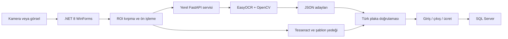

# Kamera Destekli Plaka Tanımalı Otopark Otomasyonu

[](https://github.com/cantsdlnn/kamerali-plaka-tanimali-otopark-otomasyonu/actions/workflows/ci.yml)
[](https://dotnet.microsoft.com/)
[](https://www.python.org/)
[](LICENSE)

Kamera veya görsel üzerinden plaka okuyabilen; araç giriş-çıkışı, park yeri doluluğu, ücretlendirme, ödeme ve raporlama süreçlerini yöneten masaüstü uygulaması.

_A portfolio-oriented parking automation project combining .NET 8 WinForms, SQL Server and a local FastAPI/EasyOCR service._

> Bu proje eğitim ve portföy amacıyla geliştirilmiştir. Bir üretim ürünü olduğu iddia edilmez; gerçek kullanım öncesinde kurumun güvenlik, KVKK, operasyon ve donanım gereksinimlerine göre ek çalışma gerekir.

## Neyi gösteriyor?

- Katmanlara ayrılmış C#/.NET masaüstü uygulaması
- Kamera, görüntü ön işleme ve birden fazla OCR yönteminin birlikte kullanımı
- C# ile Python arasında HTTP/JSON ve `multipart/form-data` entegrasyonu
- Parametreli SQL sorguları ve transaction tabanlı giriş/çıkış işlemleri
- Türk plaka biçimi doğrulaması ve OCR karakter hatası düzeltme kuralları
- Saatlik tarife, günlük üst sınır, ödeme ve raporlama akışları
- PBKDF2 tabanlı parola saklama ve eski hash kayıtlarının girişte yükseltilmesi
- Otomatik .NET/Python testleri ve GitHub Actions doğrulaması

## Mimari



Python servisi öncelikli OCR yoludur. Yeterli güvenle geçerli bir sonuç üretilemezse C# tarafındaki Tesseract, şablon eşleştirme ve kontrollü manuel giriş akışları devreye girebilir. Ayrıntılar için [mimari dokümanına](docs/architecture.md) bakın.

## Teknoloji yığını

| Katman | Teknolojiler |
|---|---|
| Masaüstü | C#, .NET 8, Windows Forms |
| Görüntü işleme | OpenCvSharp, OpenCV, NumPy |
| OCR | EasyOCR, Tesseract, karakter şablonu yedeği |
| Yerel servis | Python 3.11, FastAPI, Uvicorn |
| Veritabanı | Microsoft SQL Server, ADO.NET, Microsoft.Data.SqlClient |
| Test | xUnit, pytest |
| Otomasyon | GitHub Actions, Dependabot |

## Proje yapısı

```text
.
├── .github/                              # CI ve bağımlılık güncellemeleri
├── docs/                                 # Gereksinimler, mimari, tehdit modeli, ADR'ler
├── PlakaTanimaliOtoparkOtomasyonu/       # WinForms uygulaması
│   ├── DataAccess/                       # Repository ve SQL erişim katmanı
│   ├── Forms/                            # Kullanıcı arayüzü
│   ├── Helpers/                          # Doğrulama, parola ve UI yardımcıları
│   ├── Models/                           # Veri modelleri
│   ├── Services/                         # Kamera, OCR, otopark ve ücret servisleri
│   ├── SqlScripts/                       # Şema ve örnek park/tarife verisi
│   ├── Templates/                        # Karakter eşleştirme şablonları
│   └── tessdata/                         # Tesseract dil verisi
├── PlakaTanimaliOtoparkOtomasyonu.Tests/ # 21 xUnit testi
└── PythonPlateReader/                    # FastAPI servisi ve 27 pytest testi
```

## Gereksinimler

- Windows 10/11
- .NET 8 SDK veya Visual Studio 2022
- Microsoft SQL Server / SQL Server Express
- Python 3.11
- İsteğe bağlı web kamerası

Donanım, yazılım ve kapsam gereksinimlerinin tamamı [docs/requirements.md](docs/requirements.md) dosyasındadır.

## Hızlı başlangıç

### 1. Veritabanını hazırlayın

`PlakaTanimaliOtoparkOtomasyonu/SqlScripts` altındaki dosyaları sırasıyla çalıştırın:

1. `01_CreateDatabaseAndTables.sql`
2. `02_SeedData.sql`

`03_UpdatePlakaOkumaKayitlari.sql` yalnızca eski bir şemayı güncellemek içindir. Seed betiği güvenlik gereği varsayılan kullanıcı veya parola oluşturmaz.

Varsayılan bağlantı Windows kimlik doğrulamasıyla yerel SQL Server kullanır. Farklı bir bağlantı gerekiyorsa kaynak dosyayı değiştirmek yerine süreç ortamında ayarlayın:

```powershell
$env:OTOPARK_DB_CONNECTION_STRING = "Server=localhost\SQLEXPRESS;Database=PlakaTanimaliOtoparkDb;Trusted_Connection=True;TrustServerCertificate=True;"
```

### 2. İlk yerel yöneticiyi tanımlayın

Boş kullanıcı tablosunda ilk yönetici yalnızca ortam değişkenlerinden oluşturulur. Parola en az 12 karakter olmalı, harf ve rakam içermelidir.

```powershell
$env:OTOPARK_BOOTSTRAP_ADMIN_USER = "yerel-yonetici"
$env:OTOPARK_BOOTSTRAP_ADMIN_PASSWORD = "kendinize-ozel-guclu-bir-parola-2026"
$env:OTOPARK_BOOTSTRAP_ADMIN_NAME = "Yerel Yönetici"
```

Bu değerleri repoya, `.env` dosyasına veya ekran görüntüsüne eklemeyin. İlk hesap oluşturulduktan sonra bootstrap değişkenleri artık kullanılmaz ve terminal oturumu kapatılarak bellekten kaldırılabilir.

### 3. Python OCR servisini başlatın

```powershell
cd PythonPlateReader
py -3.11 -m venv .venv
.\.venv\Scripts\Activate.ps1
python -m pip install --upgrade pip
pip install -r requirements.txt
uvicorn app:app --host 127.0.0.1 --port 8000
```

Servis bilerek yalnızca loopback istemcilerini kabul eder. Tam OCR kurulumu PyTorch ve EasyOCR modelleri nedeniyle büyük olabilir; EasyOCR ilk çalışmada model indirebilir. Sağlık kontrolü: `http://127.0.0.1:8000/health`.

### 4. Masaüstü uygulamasını çalıştırın

```powershell
dotnet restore .\PlakaTanimaliOtoparkOtomasyonu.sln --locked-mode
dotnet run --project .\PlakaTanimaliOtoparkOtomasyonu\PlakaTanimaliOtoparkOtomasyonu.csproj
```

## Testler

```powershell
dotnet test .\PlakaTanimaliOtoparkOtomasyonu.sln -c Release

cd PythonPlateReader
py -3.11 -m venv .venv
.\.venv\Scripts\Activate.ps1
pip install -r requirements-dev.txt
python -m pytest tests -q
```

9 Eylül 2026 tarihinde temiz bağımlılık geri yüklemesi sonrasında elde edilen yerel durum:

| Kontrol | Sonuç |
|---|---|
| `.NET Release` derlemesi | Başarılı — 0 uyarı, 0 hata |
| xUnit | 21/21 başarılı |
| Python `compileall` | Başarılı |
| pytest | 27/27 başarılı |
| Python Ruff | Lint ve biçim kontrolü başarılı |
| NuGet / Python üst düzey bağımlılık taraması | Bilinen açık bulunmadı |

Testler; plaka temizleme/doğrulama, OCR karakter düzeltme kuralları, ücret hesaplama, PBKDF2/legacy hash davranışı, yükleme sınırı, MIME türü ve loopback denetimini kapsar. SQL Server, fiziksel kamera ve gerçek OCR modeli uçtan uca testleri henüz otomatik değildir.

## Güvenlik ve veri sorumluluğu

- Repoda gerçek plaka, araç sahibi, telefon veya veritabanı yedeği bulunmaz; eklenmemelidir.
- Çalışma sırasında alınan plaka görselleri hassas veri kabul edilmelidir.
- OCR servisi kimlik doğrulama sunmaz ve internete açılmak üzere tasarlanmamıştır.
- Yeni parolalar PBKDF2-HMAC-SHA256, rastgele salt ve 600.000 iterasyonla saklanır.
- Eski 64 karakterlik SHA-256 kayıtları yalnızca geçiş uyumluluğu için doğrulanır ve başarılı girişte PBKDF2'ye yükseltilir.

Güvenlik sınırları ve kalan riskler için [SECURITY.md](SECURITY.md) ile [tehdit modelini](docs/threat-model.md) okuyun.

## Bilinen sınırlar

- Plaka alanı bir nesne tespit modeliyle otomatik bulunmaz; ROI kullanılır.
- Başarı oranı ışık, açı, hareket, çözünürlük ve kamera kalitesine bağlıdır.
- Projede özel eğitilmiş bir yapay zekâ modeli yoktur; hazır OCR motorları mühendislik kurallarıyla birleştirilmiştir.
- Gerçek plaka görüntülerinden oluşturulmuş, repoya eklenebilir lisanslı/anonim bir benchmark veri seti henüz yoktur.
- Masaüstü uygulaması yalnızca Windows hedefler.

## Geliştirme yaklaşımım ve AI kullanımı

Üretken yapay zekâyı araştırma, alternatif çözüm üretme, test senaryosu genişletme, kod gözden geçirme ve dokümantasyon desteği için kullandım. Mimariyi, C#–Python iletişimini, veri modelini ve güvenlik kararlarını anlayarak değerlendirdim; önerileri doğrudan kabul etmek yerine derleme, test ve kod incelemesiyle doğruladım. Ayrıntılı beyan: [AI_USAGE.md](AI_USAGE.md).

## Yol haritası

- Sentetik ve paylaşılabilir plaka veri setiyle OCR benchmark'ı
- YOLO benzeri bir modelle otomatik plaka lokalizasyonu
- SQL Server entegrasyon testleri
- Yapılandırılabilir görsel saklama ve otomatik silme politikası
- Uygulamayla birlikte yönetilen Python servis yaşam döngüsü

## Dokümantasyon

- [Gereksinimler](docs/requirements.md)
- [Mimari](docs/architecture.md)
- [Tehdit modeli](docs/threat-model.md)
- [Yerel test raporu](docs/test-report.md)
- [Mimari karar kayıtları](docs/adr/)
- [Katkı rehberi](CONTRIBUTING.md)
- [Değişiklik günlüğü](CHANGELOG.md)
- [Üçüncü taraf bildirimleri](THIRD_PARTY_NOTICES.md)

## Lisans

Kaynak kod [MIT Lisansı](LICENSE) ile sunulur. Üçüncü taraf bileşenlerin kendi lisansları geçerlidir.
