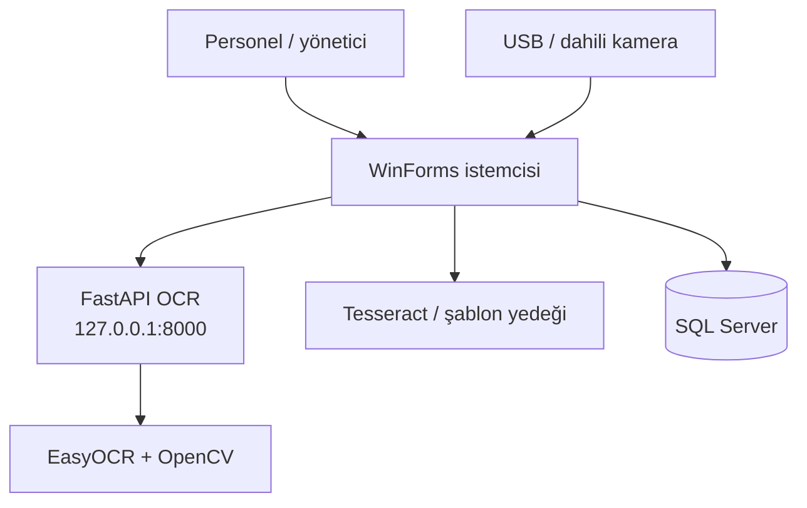
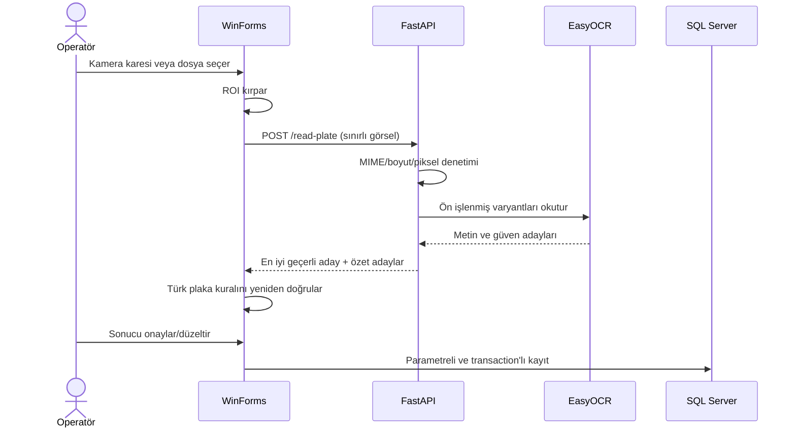

# Mimari

## Bağlam

Uygulama, Windows masaüstü istemcisi çevresinde çalışan yerel bir sistemdir. Kamera ve kullanıcı etkileşimi WinForms içinde yönetilir; hesaplama ve veri erişim kuralları ayrı sınıflardadır. EasyOCR bağımlılığı Python sürecinde izole edilmiştir.

## Katmanlar

| Katman | Sorumluluk |
|---|---|
| `Forms` | Kullanıcı etkileşimi, ekran durumu ve operasyon onayı |
| `Services` | OCR koordinasyonu, giriş/çıkış ve ücret iş kuralları |
| `DataAccess` | Parametreli SQL, transaction ve satır-model eşleme |
| `Models` | Uygulama veri sözleşmeleri |
| `Helpers` | Plaka doğrulama, parola güvenliği ve ortak UI yardımcıları |
| `PythonPlateReader` | Yerel OCR HTTP sınırı, görüntü ön işleme ve aday puanlama |

## Plaka okuma dizisi

## Kimlik doğrulama akışı

Yeni veritabanı kullanıcı içermez. İlk giriş denemesinde uygulama kullanıcı tablosunu kontrol eder; boşsa `OTOPARK_BOOTSTRAP_ADMIN_*` ortam değişkenlerinden tek bir yönetici oluşturur. Parola PBKDF2-HMAC-SHA256 ile türetilir. Eski kurulumdaki 64 karakterlik SHA-256 hash başarılı biçimde doğrulanırsa aynı transaction dışı, koşullu güncellemede yeni PBKDF2 hash ile değiştirilir.

## Veri tutarlılığı

- Araç girişi; aktif kayıt denetimi, park yeri denetimi, kayıt ekleme ve doluluk güncellemesini tek SQL transaction içinde yürütür.
- Araç çıkışı; park kaydını kapatma, park yerini boşaltma ve ödeme eklemeyi tek transaction içinde yürütür.
- Kullanıcı girdisi SQL metnine birleştirilmez; `SqlParameter` kullanılır.

## Hata toleransı

- Python servisi çalışmazsa C# OCR yedekleri ve manuel onay akışı kullanılabilir.
- OCR kaydı veritabanına yazılamadığında demo akışı devam eder; bu tercih üretimde gözlemlenebilir loglama ile değiştirilmelidir.
- Kamera, SQL ve OCR hataları UI düzeyinde kullanıcıya kontrollü mesaj olarak taşınır.

## Dağıtım sınırı

Bu sürüm tek makine/yerel ağ dışı kullanım için tasarlanmamıştır. FastAPI süreci `127.0.0.1` adresine bağlanmalı; SQL Server erişimi işletim sistemi ve veritabanı yetkileriyle sınırlandırılmalıdır.
