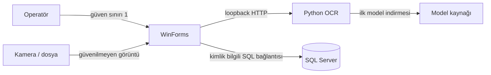

# Tehdit modeli

## Kapsam ve güven sınırları

Korunan varlıklar: kullanıcı parola hash'leri, plaka ve araç bilgileri, giriş/çıkış zamanları, ödeme kayıtları, kamera görüntüleri ve SQL bağlantı bilgileri.

## Başlıca tehditler

| Tehdit | Etki | Mevcut kontrol | Kalan çalışma |
|---|---|---|---|
| Varsayılan/parolası bilinen hesap | Yetkisiz erişim | Seed hesapları kaldırıldı; ortam değişkenli bootstrap | Hesap yönetimi ve parola değiştirme ekranı |
| Parola veritabanının ele geçirilmesi | Offline parola denemesi | PBKDF2-SHA256, rastgele 16 bayt salt, 600.000 iterasyon | Kurumsal kimlik sağlayıcı seçeneği |
| Eski SHA-256 kayıt | Hızlı offline kırma | Başarılı girişte otomatik migration | Eski hesaplara zorunlu parola sıfırlama planı |
| SQL injection | Veri kaybı/ifşa | Parametreli sorgular | Otomatik güvenlik testleri |
| Eşzamanlı giriş/çıkış yarışı | Tutarsız doluluk/ödeme | SQL transaction ve durum kontrolleri | Yük/eşzamanlılık entegrasyon testi |
| Kötü amaçlı/büyük görsel | Bellek/CPU tüketimi | MIME, 5 MiB ve 16 MP varsayılan sınırlar | İstek zaman aşımı ve rate limit |
| OCR servisinin ağa açılması | Yetkisiz yoğun işlem/veri ifşası | Loopback bind talimatı + loopback middleware | Remote kullanım için auth/TLS gateway |
| Plaka görsellerinin kalıcı kalması | Kişisel veri ihlali | Git ignore kuralları ve dokümantasyon | Yapılandırılabilir retention/otomatik silme |
| Hassas config commit'i | Kimlik bilgisi ifşası | Ortam değişkeni önceliği, `.env` ignore | Secret scanning iş akışı |
| OCR yanlış pozitif | Yanlış araç işlemi | Format kontrolü ve operatör onayı | Lisanslı benchmark ve eşik kalibrasyonu |
| Bağımlılık tedarik zinciri | Kod çalıştırma/kararsızlık | Sürüm sabitleme, lock dosyası, Dependabot | İmzalı release/SBOM |

## Yerel OCR servisi kararı

`PLATE_READER_ALLOW_REMOTE=true` yalnızca kontrollü bir deney ortamında kullanılmalıdır. Bu bayrak tek başına servisi güvenli uzaktan API yapmaz; kimlik doğrulama, TLS, ters proxy, rate limit ve ağ segmentasyonu ayrıca gerekir.

## Kişisel veri yaşam döngüsü

1. Kamera/görsel operatör tarafından seçilir.
2. ROI geçici veya çalışma dizininde işlenir.
3. OCR sonucu ve isteğe bağlı görsel yolu SQL kaydına girebilir.
4. Repo, gerçek görüntü ve veritabanı dosyalarını dışlar.
5. Gerçek kurulum sahibi erişim, yedek, saklama süresi ve silme politikasını tanımlamalıdır.

Bu sürüm otomatik retention uygulamaz; üretim öncesi kapanması gereken açık risktir.
